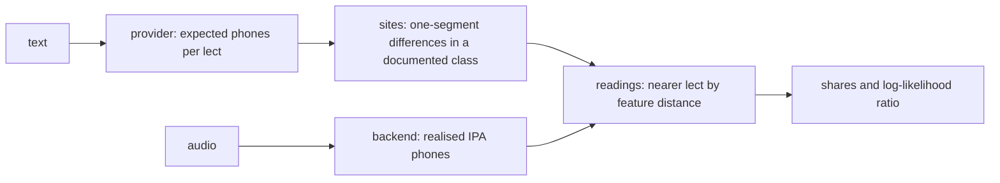
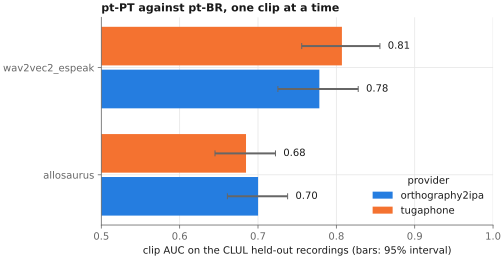

# Lect fidelity
<!-- agent-hint
covers: how lect_fidelity reads one lect against another, its API, its calibration and its measured AUC
source: speechonnxmetrics/lect_fidelity/, speechonnxmetrics/data/lect_calibration.json, evaluation/lect_fidelity/
generated: the AUC table and the figure come from speechonnxmetrics/data/lect_calibration.json through docs/img/plot_lect_auc.py
verify: python -m pytest -q test/test_docs.py -k "lect"
see: models.md
-->

`lect_fidelity` measures how far a clip of known text realises one lect of a language
against another, for example European against Brazilian Portuguese. This page shows
the API, the three steps of the metric and its results on real speech.

The metric is not in the `score()` registry, because it needs the text and the two
lects. It needs the `lect` extra.

## Example

The call downloads the Allosaurus model, so this page shows it without output:

```python
from speechonnxmetrics.lect_fidelity import LectFidelity

scorer = LectFidelity(("pt-PT", "pt-BR"))  # Allosaurus backend, orthography2ipa provider
result = scorer.score("clip.wav", "Os meninos partiram mais cedo.")
if result is not None:
    result.shares                 # percent of sites read as pt-PT, pt-BR or neither
    result.shares_by_level        # the same, with pre-lexical and post-lexical apart
    result.log_likelihood_ratio, result.decision
    for row in result.report():
        row["class"], row["context"], row["expected.pt-PT"], row["expected.pt-BR"], row["realised"], row["reading"]

pooled = scorer.pool([scorer.score(path, text) for path, text in clips_of_one_voice])
pooled.duration, pooled.posterior, pooled.shares
```

`LectFidelity(lects, backend="allosaurus", *, provider="orthography2ipa",
calibration="shipped", restrict_inventory=None)` loads no model. `calibration="shipped"`
takes the table for this provider and backend. `restrict_inventory=None` follows the
calibration.

## How the metric works



1. **Expected phones.** A provider gives the readings of each word in each lect. The
   default is `orthography2ipa`. `provider="tugaphone"` adds number verbalisation,
   homograph marks and the `tugalex` lexicon, and needs the `lect-tugaphone` extra. A
   provider implements `PhoneProvider.candidates(text, lect)`, so another phonemizer
   can take its place. The candidates of a word are its reading in the sentence, its
   reading alone and the free variants of the spec. Thus an optional process that the
   spec permits counts as a permitted reading, not as a miss.
2. **Sites.** The metric aligns the readings of the two lects. A one-segment difference
   becomes a *site* only in a class of `SITE_CLASSES` in
   `speechonnxmetrics/lect_fidelity/sites.py`: coda s, unstressed e, unstressed o, t and
   d before i, and coda l. The metric excludes and counts three types of difference: a
   difference fused with a neighbouring difference, a site whose candidate sets
   overlap, and a difference outside the classes. Unstressed reduction is pre-lexical.
   Coda s, coda l and affrication are post-lexical. The result reports the two levels
   apart.
3. **Readings.** A phone recogniser writes the audio as IPA phones. `allosaurus` is
   the default backend. The metric reads each site as the lect whose candidates hold the
   nearer phone by phonetic feature distance, or as neither. A deleted segment counts
   only when the recogniser heard the phones around it.

European word-final e of a stressed word can drop only before a word that starts with
a vowel (`sabe o` read `ˈsab u`). A proclitic keeps it (`que o` read `kɨ u`). Before a
consonant or at the end of an utterance the specs keep it, so a missing final e there
reads as neither lect.

A clip returns `None`, with no verdict, in three cases. The constants are in
`speechonnxmetrics/lect_fidelity/scoring.py`:

| Constant | Value | The clip returns `None` when |
| :--- | :--- | :--- |
| `MIN_PHONES` | 4 | it has fewer realised phones |
| `MIN_COVERAGE` | 0.4 | its realised phones are fewer than this share of the expected count |
| `MAX_COVERAGE` | 2.0 | its realised phones are more than this multiple of the expected count, such as a short clip repeated for minutes |

## Calibration

The result of a clip is the shares and a log-likelihood ratio summed over its sites.
The ratio uses the reliability of each site class, measured on real speech of both
lects. The table is `speechonnxmetrics/data/lect_calibration.json`, with one entry for
each provider and backend. Each entry records its corpora, its clip counts and the
package versions of the measurement. `evaluation/lect_fidelity/build_table.py` writes
it from the output of `evaluation/lect_fidelity/evaluate.py`.

The table serves both lect orders. `("pt-BR", "pt-PT")` gives the same verdict as
`("pt-PT", "pt-BR")`, and the log-likelihood ratio favours the lect that you name
first. A class whose readings do not differ between the lects at a z of 1.96
(`USABLE_Z` in `calibration.py`) carries no weight. Unstressed o has no sites, because
the Brazilian spec permits `u` there too.

The pooled result gives a posterior over the lects and the pooled duration. A single
clip gives no posterior, because a clip of a few seconds holds too few sites.

## Results on real speech

The calibration and the main measurement use one corpus that holds both lects, so the
corpus cannot be what separates them. The corpus is the CLUL corpus "Spoken
Portuguese: Geographical and Social Varieties": sentence clips of interviews recorded
in Portugal and Brazil (`Jarbas/SpokenPortugueseGeographicalSocialVarieties_splits`,
MIT). The split is by recording, so no recording is on both sides.
`evaluation/lect_fidelity/clul-split.json` names the training and held-out recordings.
compare-accents-pt, one paragraph read by each of twenty speakers, is a second test.
The wav2vec2 entries use a subset of clips, named in
`evaluation/lect_fidelity/wav2vec2-clips.json`, because that model runs slower on CPU.

<picture>
  <source media="(prefers-color-scheme: dark)" srcset="img/lect-auc-dark.svg">
  
</picture>

`img/plot_lect_auc.py` makes this figure from `speechonnxmetrics/data/lect_calibration.json`.

| Backend | Provider | CLUL held-out, clip AUC (95% interval) | compare-accents-pt, clip AUC (95% interval) |
| :--- | :--- | :--- | :--- |
| `allosaurus` | `orthography2ipa` | 0.70 (0.66 to 0.74) | 1.00 (1.00 to 1.00) |
| `allosaurus` | `tugaphone` | 0.68 (0.65 to 0.72) | 1.00 (1.00 to 1.00) |
| `wav2vec2_espeak` | `orthography2ipa` | 0.78 (0.73 to 0.83) | 0.99 (0.93 to 1.00) |
| `wav2vec2_espeak` | `tugaphone` | 0.81 (0.76 to 0.86) | 1.00 (1.00 to 1.00) |

The AUC is that of the clip log-likelihood ratio, with a stratified bootstrap 95%
interval. Decoding is restricted to the union of the phones of the two lects, as in
the shipped calibration. The table holds the results of the package versions in `provenance.packages` of each
entry, which can be older than the floors of the `lect` extra. `evaluate.py` also gives clip accuracy, accuracy for each
recording with its clips pooled, and AUC by duration bin.

One clip of a few seconds holds few sites, and the recogniser often misses the vowel
or the sibilant there. Thus one clip is weak evidence. Pool the clips of one speaker
for a verdict on that speaker.

`wav2vec2_espeak` learned Portuguese from Common Voice clips with labels from the
European voice of espeak-ng. Thus it tends to write European phones for Brazilian
speech. It is not the default.

## Add a language pair

1. Document the site classes of the pair, as `SITE_CLASSES` in
   `speechonnxmetrics/lect_fidelity/sites.py` does for Portuguese. The scorer refuses a
   pair without classes.
2. Measure a calibration on real speech of both lects with the scripts in
   `evaluation/lect_fidelity/`.

## Tests

The lect-fidelity tests run without the real models. Two one-layer ONNX graphs with the
shapes of the recognisers run the full path of each backend. A stored output of the
Allosaurus feature model tests the numpy frontend. The Allosaurus parity tests download
its export from the pinned revision. The wav2vec2 parity test runs only when
`SPEECHONNXMETRICS_LECT_MODELS` names a directory that holds
`wav2vec2_xlsr53_espeak_cv_ft.onnx`. The synthesised test clips come from Piper voices
fine-tuned from a voice trained on research-only data, so their terms of
redistribution are not clear. Their manifest records the lineage.

---
[← Metrics reference](metrics.md) · [Home](index.md) · [Models and licences →](models.md)
